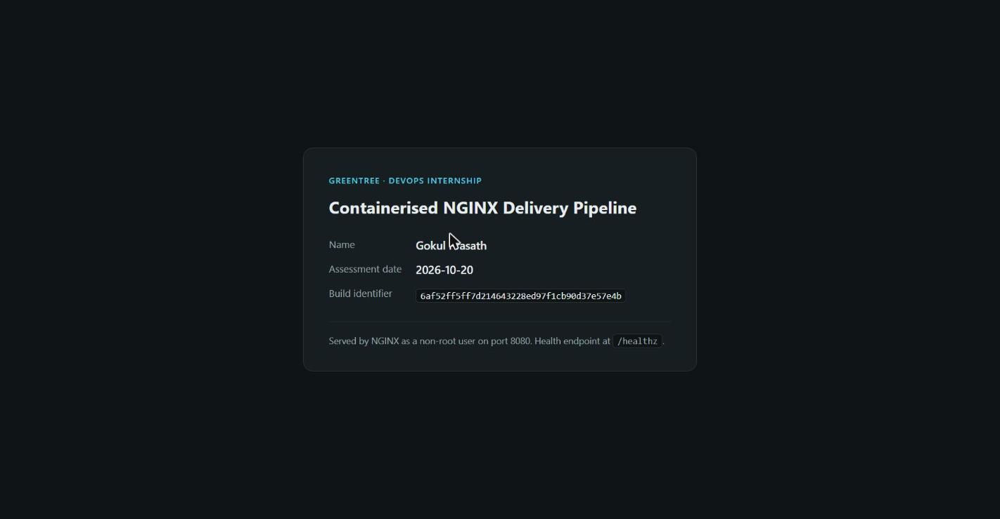
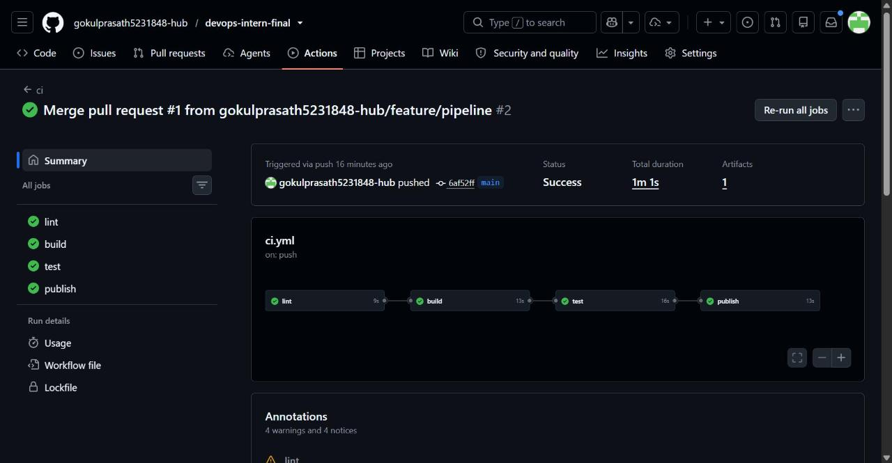
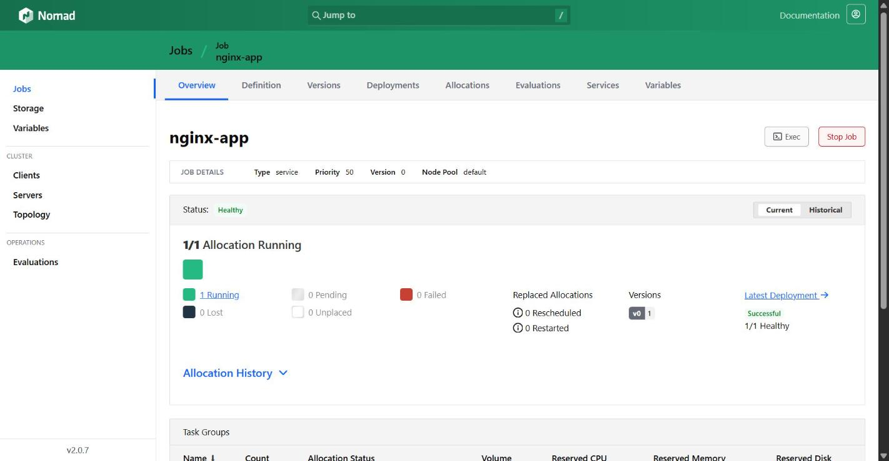
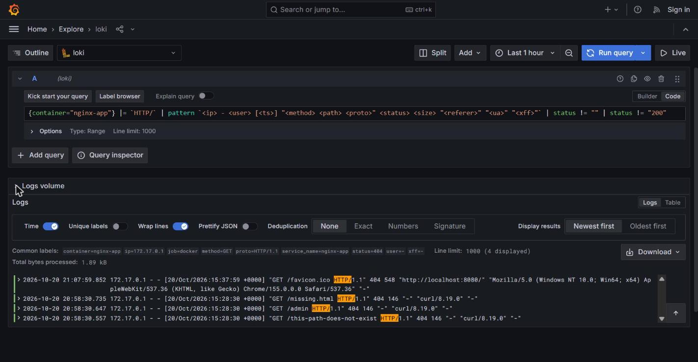

# devops-intern-final

[](https://github.com/gokulprasath5231848-hub/devops-intern-final/actions/workflows/ci.yml)

End-to-end delivery pipeline for a containerised NGINX site: source control
through build, automated CI, orchestrated deployment on Nomad, and log
aggregation with Grafana Loki.

| | |
|---|---|
| **Name** | Gokul Prasath |
| **Submission date** | 2026-10-20 |
| **Assigned by** | Friendy |
| **Repository** | `devops-intern-final` |

## Architecture

```
  developer
      |
      | git push  (feature/* -> pull request -> main)
      v
  +---------------------+
  |   GitHub (source)   |
  +---------------------+
      |
      | workflow: .github/workflows/ci.yml
      v
  +-----------------------------------------------------------+
  |  lint  ->  build  ->  test  ->  publish                    |
  |                                                            |
  |  shellcheck    docker build    start container   push to   |
  |  hadolint      BUILD_SHA=sha   healthcheck.sh    GHCR      |
  |                                must return 200   sha+latest|
  +-----------------------------------------------------------+
      |
      | ghcr.io/gokulprasath5231848-hub/devops-intern-final:<sha>
      v
  +---------------------+        registers        +------------+
  |  Nomad  (docker)    | ----------------------> |   Consul   |
  |  nginx-app / web    |   http check /healthz   +------------+
  |  dynamic port -> 8080                         
  +---------------------+
      |
      | container stdout / stderr
      v
  +------------+      push      +---------+     query     +-----------+
  |  Promtail  | -------------> |  Loki   | <------------ |  Grafana  |
  |  docker_sd |                |  :3100  |     LogQL     |  :3000    |
  +------------+                +---------+               +-----------+
```

The image that CI tests is the exact image that CI publishes: the `build`
job exports it as an artifact, `test` loads and exercises that artifact, and
`publish` re-tags and pushes the same artifact. Nothing is rebuilt between
test and release.

## Prerequisites

| Tool | Pinned version | Used for |
|---|---|---|
| Docker Engine | 29.7.2 | Building and running the image |
| Docker Compose | v2 (bundled) | Monitoring stack |
| Nomad | 2.0.7 | Orchestration (Linux build, run in WSL2) |
| Consul | 2.0.4 | Service registration and health checks |
| ShellCheck | 0.10.0 | Shell linting |
| hadolint | 2.12.0 | Dockerfile linting |
| Git | 2.54 | Source control |

Base images are pinned in the same way: `nginx:1.27-alpine-slim`,
`grafana/loki:3.0.0`, `grafana/promtail:3.0.0`, `grafana/grafana:11.1.0`.
No `latest` tag is used as a base image or as the only deployment tag.

## Quick Start

Clone to a running application in five commands:

```sh
git clone https://github.com/gokulprasath5231848-hub/devops-intern-final.git
cd devops-intern-final
docker build --build-arg BUILD_SHA="$(git rev-parse HEAD)" --tag nginx-app:local app
docker run --detach --name nginx-app --publish 8080:8080 nginx-app:local
./scripts/healthcheck.sh http://localhost:8080/healthz
```

Then open <http://localhost:8080>. Tear down with:

```sh
docker rm --force nginx-app
```

## Repository layout

```
devops-intern-final/
├── README.md
├── .gitignore
├── .gitattributes
├── app/
│   ├── Dockerfile
│   ├── index.html
│   └── nginx.conf
├── scripts/
│   ├── sysinfo.sh
│   └── healthcheck.sh
├── .github/
│   └── workflows/
│       └── ci.yml
├── nomad/
│   └── nginx-app.nomad.hcl
├── monitoring/
│   ├── loki-config.yaml
│   ├── promtail-config.yaml
│   ├── docker-compose.yaml
│   └── loki_setup.md
└── docs/
    └── screenshots/
```

`.gitattributes` is an addition to the required layout. It forces LF line
endings, without which shell scripts authored on Windows are committed with
CRLF and fail inside Linux containers with `bad interpreter`.

## Task 1 — Source control

Work was done on `feature/pipeline` and merged into `main` through a pull
request. Commits are incremental and follow conventional commit messages.

```sh
git log --oneline --graph
```

Abbreviated hashes below are from `feature/pipeline` before the merge.

```
* 224821a feat(monitoring): add loki, promtail and grafana stack with setup notes
* dda457b feat(nomad): add nginx service job with consul check and rolling update
* eeaa3db ci: add lint, build, test and publish pipeline
* ccd5cab feat(scripts): add sysinfo and healthcheck shell scripts
* 8091f05 fix(app): use alpine-slim base and chown after config test
* 01a6fe1 feat(app): add non-root dockerfile with build sha injection
* 04703ec feat(app): add nginx config and static index page
* 3c62e4f chore: enforce lf line endings via gitattributes
* 6b7af75 chore: initialise repository skeleton
```

The release is tagged `v1.0.0`:

```sh
git tag -a v1.0.0 -m "DevOps intern final assessment"
git push origin v1.0.0
```

## Task 2 — Linux scripting

Both scripts start with a shebang and `set -euo pipefail`, are executable
in Git (mode `100755`, not just on disk), and pass ShellCheck with no
findings.

```sh
git ls-files -s scripts/
```

```
100755 01115bfda29d40b640505f1a69a716e627d3bf54 0	scripts/healthcheck.sh
100755 27d59ec3332c03e2264e69cf6acf34e8cd7483ea 0	scripts/sysinfo.sh
```

### `scripts/sysinfo.sh`

Reports the host environment. Observed output:

```
===== System Information =====

User:             ADMIN
Effective UID:    197609
Hostname:         DESK-gbu
Kernel release:   3.6.7-fb42d713.x86_64
Date (ISO-8601):  2026-10-20T08:41:04Z

----- Disk usage -----
Filesystem            Size  Used Avail Use% Mounted on
C:/Program Files/Git  246G  202G   44G  83% /
S:                     76G   20G   57G  26% /s
```

Memory reporting falls back from `free` to `/proc/meminfo`, and the Docker
section reports `not installed`, `running (server <version>)`, or
`installed but the daemon is not responding`.

### `scripts/healthcheck.sh`

Takes a target URL as `$1`, defaulting to `http://localhost:8080`, asserts
a 200, and exits non-zero with a diagnostic on failure.

```sh
./scripts/healthcheck.sh http://localhost:8080/healthz   # exit 0
./scripts/healthcheck.sh                                 # exit 0, default URL
./scripts/healthcheck.sh http://localhost:8080/missing   # exit 1
./scripts/healthcheck.sh http://localhost:9999           # exit 1
```

Observed output:

```
healthcheck: OK - http://localhost:8080/healthz returned 200
healthcheck: OK - http://localhost:8080 returned 200
healthcheck: FAIL - http://localhost:8080/missing returned 404, expected 200
healthcheck: FAIL - no HTTP response from http://localhost:9999 within 10s
```

### Linting

```sh
docker run --rm -v "$PWD:/mnt" -w /mnt koalaman/shellcheck:v0.10.0 \
  scripts/sysinfo.sh scripts/healthcheck.sh
```

Both scripts produce no output and exit 0.

## Task 3 — Containerisation

```sh
docker build --build-arg BUILD_SHA=local-test --tag nginx-app:local app
docker run --detach --name nginx-app --publish 8080:8080 nginx-app:local
```

| Requirement | How it is met |
|---|---|
| Pinned base tag | `FROM nginx:1.27-alpine-slim` |
| Static site on 8080 | `listen 8080` in `app/nginx.conf` |
| `/healthz` returns 200 | `location = /healthz { return 200 "ok\n"; }` |
| Non-root runtime | `USER nginx` (uid 101) |
| `EXPOSE` | `EXPOSE 8080` |
| `HEALTHCHECK` | `wget` against `/healthz`, 30s interval |
| `BUILD_SHA` surfaced | `X-Build-Sha` response header **and** rendered in the page |
| Image under 60 MB | **19.5 MB** |

Observed verification:

```
$ docker images nginx-app:local --format '{{.Size}}'
19.5MB

$ docker exec nginx-app id
uid=101(nginx) gid=101(nginx) groups=101(nginx)

$ curl -s -o /dev/null -w 'status=%{http_code}\n' http://localhost:8080/healthz
status=200

$ curl -s http://localhost:8080/healthz
ok

$ curl -s -D - -o /dev/null http://localhost:8080/ | grep -iE '^HTTP|x-build-sha|^server'
HTTP/1.1 200 OK
Server: nginx
X-Build-Sha: local-test

$ curl -s http://localhost:8080/ | grep -o '<code>[^<]*</code>'
<code>local-test</code>

$ curl -s -o /dev/null -w 'status=%{http_code}\n' http://localhost:8080/missing-page
status=404

$ docker inspect --format '{{.State.Health.Status}}' nginx-app
healthy
```

`Server: nginx` carries no version because `server_tokens off` is set.

Linting:

```sh
docker run --rm -i hadolint/hadolint:v2.12.0-alpine hadolint - < app/Dockerfile
```

No output, exit 0.



## Task 4 — Continuous integration

`.github/workflows/ci.yml` runs on push and pull request to `main`.

| Job | Depends on | Does |
|---|---|---|
| `lint` | — | ShellCheck on `scripts/`, hadolint on `app/Dockerfile` |
| `build` | `lint` | Builds with `BUILD_SHA=${GITHUB_SHA}`, uploads the image as an artifact |
| `test` | `build` | Loads the artifact, starts it, waits for readiness, runs `healthcheck.sh`, asserts `X-Build-Sha` |
| `publish` | `test` | Push to `main` only — tags and pushes to GHCR as `<sha>` and `latest` |

Security posture:

- Default `permissions: contents: read` at workflow level; `publish` adds
  only `packages: write`.
- Registry auth uses the ephemeral `GITHUB_TOKEN`, piped via
  `--password-stdin`. No long-lived credentials exist in the repository.
- Only first-party actions are used (`actions/checkout@v4`,
  `actions/upload-artifact@v4`, `actions/download-artifact@v4`), each
  pinned to a major version. hadolint runs from a version-pinned image
  rather than a third-party action.

The pipeline genuinely gates on the test: `healthcheck.sh` exits non-zero
on any status other than 200, which fails the `test` job and prevents
`publish` from running.

Observed on the merge of pull request #1 into `main`
(run `39448164297`):

```
lint       success
build      success
test       success
publish    success
```

The published image was pulled back from GHCR and verified end to end:

```
$ docker pull ghcr.io/gokulprasath5231848-hub/devops-intern-final:latest
Status: Downloaded newer image for ghcr.io/.../devops-intern-final:latest

$ docker images ... --format '{{.Size}}'
19.5MB

$ docker exec nginx-app id -un
nginx

$ curl -s -D - -o /dev/null http://localhost:8080/ | grep -i x-build-sha
X-Build-Sha: 6af52ff5ff7d214643228ed97f1cb90d37e57e4b

$ git rev-parse origin/main
6af52ff5ff7d214643228ed97f1cb90d37e57e4b
```

The build identifier baked into the published image matches the commit on
`main` exactly, which confirms the artifact tested by CI is the artifact
released.



## Task 5 — Orchestration with Nomad

Nomad and Consul must be the **Linux** builds. On Windows the Docker
driver refuses Linux containers — see Troubleshooting 7.

```sh
nomad job validate nomad/nginx-app.nomad.hcl
nomad job plan nomad/nginx-app.nomad.hcl
nomad job run -var="image_tag=$(git rev-parse HEAD)" nomad/nginx-app.nomad.hcl
nomad job status nginx-app
```

The image tag is an HCL variable, so a specific commit can be deployed
rather than whatever `latest` happens to point at:

```hcl
variable "image_tag" {
  type    = string
  default = "latest"
}
```

| Requirement | Value |
|---|---|
| Type | `service`, one group (`web`), one task (`nginx`), `docker` driver |
| Image | `ghcr.io/gokulprasath5231848-hub/devops-intern-final:${var.image_tag}` |
| Resources | 100 MHz CPU, 64 MB memory |
| Port | Dynamic, named `http`, mapped to container `8080` |
| Consul check | HTTP `GET /healthz`, interval `10s`, timeout `2s` |
| Update | `max_parallel = 1`, `min_healthy_time = 10s`, `healthy_deadline = 2m`, `auto_revert = true` |
| Restart | 2 attempts per 5m, 15s delay, mode `fail` |
| Reschedule | 3 attempts per 1h, exponential backoff to 5m |

Resources are left at the assessment defaults. The container is a static
NGINX serving one small page, and the image idles well inside 64 MB, so
there is nothing to justify deviating.

The job file was parsed offline to confirm the HCL and variable
interpolation are correct:

```sh
docker run --rm -v "$PWD/nomad:/job" hashicorp/nomad:1.8 \
  job run -output /job/nginx-app.nomad.hcl
```

Observed, with the stanzas rendered as Nomad will apply them (durations in
nanoseconds):

```
image   : ghcr.io/gokulprasath5231848-hub/devops-intern-final:latest
Update  : MaxParallel 1, MinHealthyTime 10000000000, HealthyDeadline 120000000000, AutoRevert true
Service : nginx-app | port http | provider consul
Check   : type http, path /healthz, Interval 10000000000, Timeout 2000000000
Restart : Attempts 2, Interval 300000000000, Delay 15000000000, Mode fail
Resched : Attempts 3, Interval 3600000000000, DelayFunction exponential, MaxDelay 300000000000
Ports   : [{"Label": "http", "Value": 0, "To": 8080}]
```

Overriding the tag resolves correctly:

```
$ ... job run -output -var='image_tag=abc123' /job/nginx-app.nomad.hcl | grep '"image"'
"image": "ghcr.io/gokulprasath5231848-hub/devops-intern-final:abc123",
```

Deployed against a Nomad 2.0.7 and Consul 2.0.4 dev cluster running inside
WSL2 (see Troubleshooting 7 for why it cannot run on Windows natively).

```
$ nomad job validate nomad/nginx-app.nomad.hcl
Job validation successful

$ nomad job plan -var="image_tag=$(git rev-parse HEAD)" nomad/nginx-app.nomad.hcl
+ Job: "nginx-app"
+ Task Group: "web" (1 create)
  + Task: "nginx" (forces create)
Scheduler dry-run:
- All tasks successfully allocated.

$ nomad job run -var="image_tag=$(git rev-parse HEAD)" nomad/nginx-app.nomad.hcl
==> Monitoring evaluation "97cee7e5"
    Allocation "bee2215e" created: node "a2117f9f", group "web"
==> Monitoring deployment "80a76bd1"
    Status = successful
    Description = Deployment completed successfully
```

Allocation healthy:

```
$ nomad job status nginx-app
ID            = nginx-app
Type          = service
Status        = running

Summary
Task Group  Queued  Starting  Running  Failed  Complete  Lost
web         0       0         1        0       0         0

Latest Deployment
ID          = 80a76bd1
Status      = successful

Deployed
Task Group  Auto Revert  Desired  Placed  Healthy  Unhealthy
web         true         1        1       1        0

Allocations
ID        Node ID   Task Group  Version  Desired  Status
bee2215e  a2117f9f  web         0        run      running
```

Consul registered the service and the health check is passing:

```
$ curl -s http://127.0.0.1:8500/v1/health/service/nginx-app
  service nginx-app  addr 127.0.0.1:21272
    check Serf Health Status      status=passing
    check healthz                 status=passing
```

The allocation serves traffic on its dynamically allocated port, and the
build identifier matches the deployed commit:

```
$ curl -s -o /dev/null -w '%{http_code}' http://127.0.0.1:21272/healthz
200
$ curl -s -o /dev/null -w '%{http_code}' http://127.0.0.1:21272/
200
$ curl -s -D - -o /dev/null http://127.0.0.1:21272/ | grep -i x-build-sha
X-Build-Sha: 7d05ac0b8e7f9c17a35332f0adbd6f09cefc1646
$ git rev-parse HEAD
7d05ac0b8e7f9c17a35332f0adbd6f09cefc1646
```

`nomad job validate` emits one warning, that the group defines services
without a `shutdown_delay`. It is not required here: a single replica with
no upstream load balancer has no connection-draining window to protect.



## Task 6 — Log aggregation with Grafana Loki

```sh
docker compose -f monitoring/docker-compose.yaml up -d
curl --silent --fail http://localhost:3100/ready
```

Promtail discovers containers through the Docker daemon and attaches
`container`, `job`, `service` and `nomad_alloc_id` labels. The status code
is deliberately **not** a label — it is parsed at query time to keep
cardinality low.

Isolating non-200 NGINX access logs:

```logql
{container="nginx-app"} |= `HTTP/`
  | pattern `<ip> - <user> [<ts>] "<method> <path> <proto>" <status> <size> "<referer>" "<ua>" "<xff>"`
  | status != ""
  | status != "200"
```

Full procedure, label table, all queries and the Grafana data source setup
are in [`monitoring/loki_setup.md`](monitoring/loki_setup.md).

Observed: Loki reported `ready`, Promtail discovered seven containers
including `nginx-app`, and after three deliberate 404 requests the query
returned exactly those three lines and nothing else.

```
$ curl --silent http://localhost:3100/loki/api/v1/label/container/values
{"status":"success","data":["grafana","kintix_backend","kintix_postgres",
 "kintix_web","loki","nginx-app","promtail"]}
```

```
172.17.0.1 - - [20/Oct/2026:15:28:30 +0000] "GET /admin HTTP/1.1" 404 146 "-" "curl/8.19.0" "-"
172.17.0.1 - - [20/Oct/2026:15:28:30 +0000] "GET /missing.html HTTP/1.1" 404 146 "-" "curl/8.19.0" "-"
172.17.0.1 - - [20/Oct/2026:15:28:30 +0000] "GET /this-path-does-not-exist HTTP/1.1" 404 146 "-" "curl/8.19.0" "-"
total matches: 3
```

`service` and `nomad_alloc_id` do not appear while the container is
started by `docker run` — those labels are read from the
`com.hashicorp.nomad.*` Docker labels and only exist once Nomad schedules
the workload.



## Troubleshooting

Failures actually encountered while building this, and how each was
resolved.

### 1. NGINX could not start as a non-root user

**Symptom.** The container exited immediately on every run:

```
2026/10/20 08:32:58 [emerg] 1#1: open() "/var/cache/nginx/nginx.pid" failed (13: Permission denied)
nginx: [emerg] open() "/var/cache/nginx/nginx.pid" failed (13: Permission denied)
```

Confusingly, the directory looked correct and a shell in the same image as
the same user could write to it:

```
$ docker run --rm --entrypoint sh nginx-app:local -c 'id; touch /var/cache/nginx/.probe'
uid=101(nginx) gid=101(nginx)
TOUCH OK
```

**Cause.** Listing numeric ownership gave it away:

```
$ docker run --rm --entrypoint sh nginx-app:local -c 'ls -lan /var/cache/nginx'
drwxr-xr-x    1 101      101   .
-rw-r--r--    1 0        0     nginx.pid
```

The directory belonged to uid 101, but `nginx.pid` belonged to **root**.
The `RUN` layer ran `chown` *before* `nginx -t`, and `nginx -t` executes as
root at build time because `USER nginx` comes later in the Dockerfile. The
config test created a root-owned pid file that the runtime user could not
reopen. Creating a *new* file succeeded, which is why the `touch` probe was
misleading.

**Resolution.** Reordered the `RUN` so validation happens before ownership
is fixed:

```dockerfile
RUN sed -i ... \
    && nginx -t \
    && chown -R nginx:nginx /var/cache/nginx /usr/share/nginx/html
```

### 2. Image was 74.5 MB against a 60 MB budget

**Symptom.** The first working image measured 73.7 MB, over the limit.
Rebuilding with `--provenance=false --sbom=false` made no difference, which
ruled out attestation metadata.

**Cause.** The base image itself:

```
nginx:1.27-alpine        74.5MB
nginx:1.27-alpine-slim   19.9MB
```

`alpine` bundles njs, geoip and perl modules that this static site does not
use. `alpine-slim` is the same NGINX without them.

**Resolution.** Switched the base to `nginx:1.27-alpine-slim`. Final image
is **19.5 MB**, comfortably inside budget, and still a pinned tag.

### 3. CI workflow was not valid YAML

**Symptom.** The workflow failed to parse:

```
Error: bad file '.github/workflows/ci.yml':
go-yaml load error in scanner at L41.C78: mapping values are not allowed in this context
```

**Cause.** This line:

```yaml
run: docker images "${IMAGE_NAME}:${GITHUB_SHA}" --format 'image size: {{.Size}}'
```

The value is an unquoted YAML scalar, and the `: ` inside the Docker format
string reads as a key/value separator. Single quotes mean nothing to the
YAML parser here — they are shell syntax, inside a scalar that YAML has
already started parsing.

**Resolution.** Moved it to a block scalar, where the colon is safe:

```yaml
run: |
  size="$(docker images "${IMAGE_NAME}:${GITHUB_SHA}" --format '{{.Size}}')"
  echo "image size is ${size}"
```

### 4. Shell scripts committed with CRLF line endings

**Symptom.** Git warned on the very first commit:

```
warning: in the working copy of '.gitignore', LF will be replaced by CRLF the next time Git touches it
```

**Cause.** Git for Windows defaults to `core.autocrlf=true`. A `.sh` file
checked out with CRLF fails inside a Linux container with
`bad interpreter: /usr/bin/env bash^M` — and it would have failed in CI,
not locally, which makes it expensive to debug.

**Resolution.** Set `core.autocrlf=false` for the repository and committed
a `.gitattributes` enforcing `eol=lf` for `*.sh`, `*.yaml`, `*.yml`,
`*.hcl`, `*.conf` and `Dockerfile`. Caught before it reached CI.

### 5. Docker Desktop backend crashed under load

**Symptom.** `docker compose up -d` for the monitoring stack aborted
mid-pull with `unexpected EOF`, then every Docker command failed:

```
failed to connect to the docker API at npipe:////./pipe/dockerDesktopLinuxEngine
```

**Cause.** The Docker Desktop backend process exited while pulling the Loki,
Promtail and Grafana images. Both WSL distributions (`docker-desktop` and
`Ubuntu`) were left `Stopped`.

**Investigation.** Relaunching brought the daemon back, but it exited again
within 60 seconds on two consecutive attempts. Disk was ruled out — 45 GB
free on C:.

**Resolution.** `wsl --shutdown` to tear the WSL backend down cleanly,
then restart Docker Desktop. The stack pulled and started normally
afterwards and has been stable since.

### 6. LogQL non-200 filter matched unparsed log lines

**Symptom.** The query meant to isolate failed NGINX requests returned
eleven lines instead of three, including NGINX's own startup output:

```
/docker-entrypoint.sh: Configuration complete; ready for start up
10-listen-on-ipv6-by-default.sh: info: can not modify /etc/nginx/conf.d/default.conf
```

**Cause.** The container writes both the access log and the entrypoint's
startup messages to stdout. `pattern` cannot parse a startup line, so no
`status` field is extracted — and in LogQL a label that does not exist is
**not** equal to `"200"`, so `| status != "200"` passed every unparseable
line through. The filter was effectively selecting parse failures.

**Resolution.** Added a line filter to restrict the stream to access log
entries before parsing, plus an emptiness guard for anything that still
fails to parse:

```logql
{container="nginx-app"} |= `HTTP/`
  | pattern `...`
  | status != ""
  | status != "200"
```

Returns exactly the three deliberate 404s.

### 7. Nomad on Windows could not schedule the Linux image

**Symptom.** With Nomad installed natively on Windows, the job would never
place. `nomad node status -self` showed:

```
docker  detected=True  healthy=False
        "Docker is configured with Linux containers; switch to Windows Containers"
```

**Cause.** Nomad's Windows build only drives Windows containers. The
assessment image is Linux (`nginx:1.27-alpine-slim`), so the two
requirements are mutually exclusive on that host: switching Docker Desktop
to Windows containers satisfies Nomad but breaks the image, and leaving it
in Linux mode satisfies the image but fails the driver fingerprint.

A second, separate failure made this slower to see. Registering the agent
as a Windows service produced `System error 1067 - the process terminated
unexpectedly`, with no log written at all. Running `nomad agent -dev` in
the foreground revealed the cause on stderr:

```
[ERROR] failed to send event to windows eventlog, timed out
```

The HashiCorp binaries do not implement the Service Control Manager
interface, so the service wrapper kills them.

**Resolution.** Ran the cluster inside WSL2 instead, where Linux Nomad
talks to Docker Desktop's Linux engine directly:

1. Enabled Docker Desktop WSL integration for the Ubuntu distribution.
2. Installed the Linux builds of Nomad 2.0.7 and Consul 2.0.4 into
   `~/bin` (static binaries, no root needed).
3. Started both as dev agents and re-ran the job.

The Docker driver then fingerprinted as `healthy=True` and the allocation
placed first time. Both UIs remain reachable from Windows on
`localhost:4646` and `localhost:8500` through WSL2 port forwarding.

Two drivers report `Driver must run as root` (`exec` and `java`) because
the agent runs as an unprivileged user. Neither is used by this job.

## Known limitations

Things that are not production-ready, and what I would change with more
time.

1. **The Nomad cluster is a single-node dev agent in WSL2.** `-dev` mode
   runs server and client in one process with no persistence, no ACLs and
   no TLS, and the whole cluster disappears when the process stops. It
   proves the job specification is correct and schedules cleanly; it is
   not a production topology.

2. **Scripts are bash, not strictly POSIX `sh`.** The brief asks for
   POSIX-compliant scripts *and* `set -euo pipefail`. `pipefail` is not in
   POSIX.1-2017 and `dash` does not implement it, so the two requirements
   conflict. I chose `#!/usr/bin/env bash`, which satisfies the explicit
   `pipefail` requirement and keeps ShellCheck clean. Dropping `pipefail`
   would make them run under `dash`.

3. **No TLS.** Traffic is plain HTTP end to end. Production would terminate
   TLS at a reverse proxy — that is the optional extension I would attempt
   next.

4. **Single replica.** `count = 1` means any node failure is an outage.
   `auto_revert` protects against a bad deploy but not against a lost node.

5. **Grafana runs with anonymous admin access.** Acceptable for a local
   assessment stack, unacceptable anywhere else. It keeps credentials out
   of the repository, but real deployments need proper auth.

6. **Loki storage is a local filesystem volume** with 168h retention and a
   replication factor of 1. There is no object storage and no backup, so
   losing the volume loses the logs.

7. **No image vulnerability scanning.** A Trivy or Grype step in `lint`
   would be a cheap, obvious addition.

8. **CI emits platform deprecation warnings.** GitHub reports that the
   bundled actions still target Node.js 20 and that `ubuntu-latest` will
   migrate to Ubuntu 26. Both are notices from the platform rather than
   defects here, and the jobs pass, but pinning the runner image to
   `ubuntu-24.04` would make the build less likely to shift underneath us.

9. **The build is not bit-for-bit reproducible.** The base tag is pinned to
   `1.27-alpine-slim`, which still floats across patch releases. Pinning by
   digest would fix it at the cost of manual update churn.

## Submission checklist

- [x] Public repository named `devops-intern-final`
- [x] Incremental commit history with conventional messages
- [x] `.gitignore` excludes `.idea/` and IDE metadata
- [x] Feature branch merged to `main` via a self-reviewed pull request
- [x] Tagged `v1.0.0` on the merged `main`
- [x] CI green on `main` — all four jobs, image published to GHCR
- [x] Published image pulled back and verified (`X-Build-Sha` matches `main`)
- [x] Loki ingesting labelled logs, non-200 LogQL query returning results
- [x] Nomad job deployed, allocation healthy, Consul check passing
- [x] Quick Start verified on a clean clone (LF endings intact, image 19.5 MB, 200 OK)
- [x] Screenshots: container, CI pipeline, Grafana Explore
- [x] Screenshot: Nomad allocation healthy
- [ ] HR tracking form submitted, DevOps Department selected
